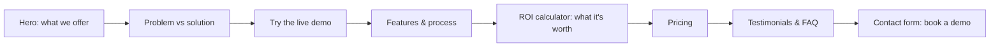
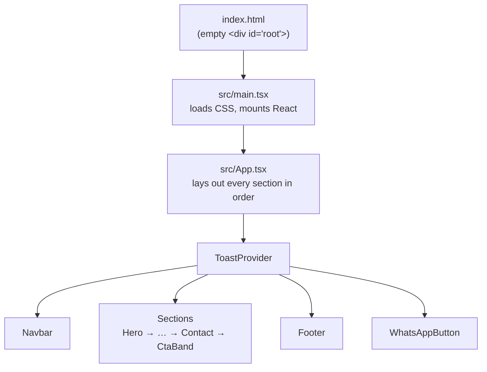
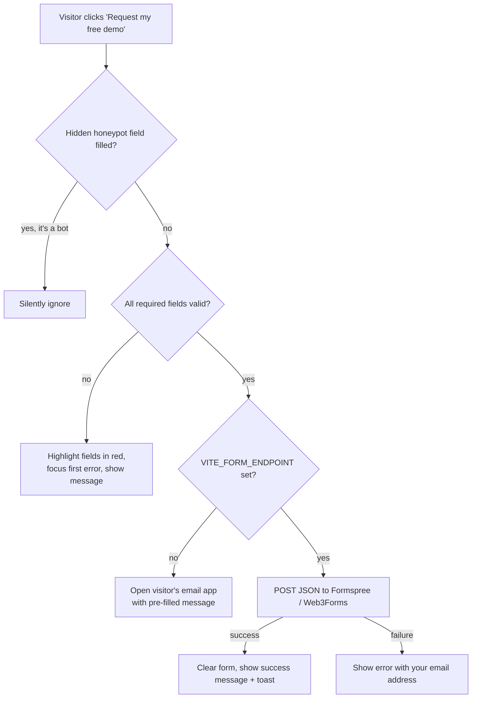

# How the Website Works

This document explains what the Nexora Health Labs website does, how the code is organised, and how each part works. It's written for you (the owner) and for any developer who works on the site later.

---

## 1. What the site is for

The site is a **sales website for your agency**. It sells **MediSlot**, a white-label doctor appointment platform, to clinics and hospitals. The goal of every section is to move a visitor (a clinic owner, doctor or hospital manager) towards **booking a demo** through the contact form or WhatsApp.

The visitor's journey down the page:



> **Important:** this is a *marketing* site. The Patient, Doctor and Admin "portals" on it are **interactive previews with sample data**. They don't save anything or connect to a database. The real product is the separate application in [`platform/`](../platform/README.md): three apps and an API sharing one SQL database.

---

## 2. Technology

| Tool | Role |
|---|---|
| **React 19** | Builds the UI out of reusable components |
| **TypeScript** | Adds types to JavaScript, so mistakes are caught before the site runs |
| **Vite** | Dev server with instant reload (`npm run dev`) and production bundler (`npm run build`) |
| **Plain CSS** | All styling in one file, `src/styles/global.css`, using CSS variables for brand colours |

There are **no other runtime libraries**: no UI kit, no router, no state library. That keeps the site fast (~85 KB of JavaScript, gzipped) and easy to understand.

---

## 3. How the site starts up



1. The browser loads `index.html`. It contains the page title, SEO tags, Google Fonts, and an empty `<div id="root">`.
2. `src/main.tsx` imports the stylesheet and tells React to render `<App />` into that div.
3. `src/App.tsx` lists every section in display order. **To reorder, add or remove a section, edit this file.**

### Development vs production

- `npm run dev`: Vite serves the source files directly and reloads the browser whenever you save.
- `npm run build`: TypeScript checks the whole project for errors (the build stops if there are any), then Vite bundles everything into a few optimised files in `dist/`. That folder is what you deploy. See [DEPLOYMENT.md](./DEPLOYMENT.md).

---

## 4. Folder structure

```
src/
├── main.tsx              Entry point
├── App.tsx               Page layout (section order)
├── config/site.ts        Business details used site-wide
├── data/
│   ├── marketing.ts      Text content: features, plans, FAQs, testimonials…
│   └── demo.ts           Sample data for the live demo
├── sections/             One file per page section
│   └── demo/             The three interactive portal previews
├── components/
│   ├── layout/           Navbar, Footer, Logo, WhatsAppButton
│   └── ui/               Small reusable building blocks
├── hooks/useInView.ts    Detects when an element scrolls into view
├── lib/
│   ├── format.ts         Formatting helpers (₹, dates, times)
│   └── leads.ts          Sends contact-form submissions
├── types/index.ts        Shared TypeScript types
└── styles/global.css     All styling
```

**Content is separated from layout.** Most text and numbers live in `config/` and `data/`, not inside the components, so you can change pricing, FAQs or contact details without touching any UI code.

---

## 5. Configuration

### `src/config/site.ts`
The single source of truth for your business details:

| Field | Used in |
|---|---|
| `agencyName`, `agencyTagline`, `agencyFullName`, `logoInitial` | Logo, footer, copyright |
| `productName` | Hero, comparison, contact, CTA |
| `email`, `phoneDisplay`, `phoneE164` | Contact section, footer, mailto fallback |
| `whatsappNumber`, `whatsappMessage` | Floating WhatsApp button |
| `location` | Contact section, footer |
| `form.endpoint`, `form.web3formsKey` | Contact form delivery (read from `.env`) |
| `navLinks` | Top navigation menu |

### Environment variables (`.env`)
| Variable | Purpose |
|---|---|
| `VITE_FORM_ENDPOINT` | Where to send contact-form submissions (Formspree or Web3Forms URL). Empty = mailto fallback. |
| `VITE_WEB3FORMS_KEY` | Access key, only for Web3Forms |
| `BASE_PATH` *(build-time, not in .env)* | Sub-path for hosting at e.g. `/repo-name/` (GitHub Pages) |

---

## 6. Section by section

| # | Section | File | Content comes from | What it does |
|---|---|---|---|---|
| 1 | Navbar | `components/layout/Navbar.tsx` | `navLinks` | Sticky top bar. Gains a shadow once you scroll. On mobile, collapses into a hamburger menu (closes on link click or Esc). |
| 2 | Hero | `sections/Hero.tsx` | `heroStats` | Headline and buttons, a mock admin dashboard with animated bars and floating notification cards, and four stats that count up when visible. |
| 3 | Logos | `sections/Logos.tsx` | `clientLogos` | Row of client names (placeholders). |
| 4 | Why clinics switch | `sections/WhySwitch.tsx` | `withoutProduct`, `withProduct`, `portals` | Before/after comparison and three cards describing the Patient, Doctor and Admin portals. |
| 5 | **Live demo** | `sections/demo/*` | `data/demo.ts` | Tabbed interactive preview. See [section 7](#7-the-live-demo). |
| 6 | Features | `sections/Features.tsx` | `features` | 9-card feature grid. |
| 7 | Process | `sections/Process.tsx` | `steps` | Dark section with 4 onboarding steps (numbered automatically). |
| 8 | **ROI calculator** | `sections/RoiCalculator.tsx` | constants in file | Sliders that estimate extra monthly revenue. See [section 8](#8-roi-calculator). |
| 9 | Pricing | `sections/Pricing.tsx` | `plans` | Three plans with an INR/USD toggle. Clicking a plan's button pre-selects it in the contact form. |
| 10 | Testimonials | `sections/Testimonials.tsx` | `testimonials` | Three quote cards (placeholders). |
| 11 | FAQ | `sections/Faq.tsx` | `faqs` | Expandable questions using native `<details>` elements. |
| 12 | **Contact** | `sections/Contact.tsx` | `site` | Demo request form. See [section 9](#9-contact-form). |
| 13 | CTA band | `sections/CtaBand.tsx` | — | Final gradient "Book a free demo" banner. |
| 14 | Footer | `components/layout/Footer.tsx` | `site` | Links, contact info, auto-updating copyright year. |
| — | WhatsApp button | `components/layout/WhatsAppButton.tsx` | `site` | Floating button that opens a WhatsApp chat with a pre-filled message. |

All in-page navigation uses anchor links (`#pricing`, `#contact`…) with smooth scrolling. The CSS offsets the scroll position so the sticky navbar doesn't cover section headings.

---

## 7. The live demo

`sections/demo/DemoSection.tsx` shows three tabs. All three panels stay mounted and are only hidden, so **each demo keeps its state** when you switch tabs. The tabs support keyboard arrow keys and proper ARIA roles for screen readers. The fake browser address bar changes per tab (`book.` / `doctor.` / `admin.yourclinic.com`).

### Patient demo (`PatientDemo.tsx`)
Simulates booking an appointment.

1. **Pick a specialty.** This swaps the doctor card (name, experience, fee) from `doctorsBySpecialty`.
2. **Pick a date.** The next 7 days are generated from today's real date.
3. **Pick a slot.** Some slots are disabled because:
   - they're in the past (only for today), or
   - they're "already booked", decided by a **seeded pseudo-random function** (`seeded()` in `data/demo.ts`). The pattern looks random but is the same on every visit, or
   - you booked them yourself in this session.
4. **Confirm booking.** Shows a toast notification ("WhatsApp confirmation sent") and marks the slot as taken. Nothing is saved; a page refresh resets it.

### Doctor demo (`DoctorDemo.tsx`)
Simulates a doctor's day.

- Shows today's date, KPIs and a patient queue (`initialQueue`).
- Clicking a patient shows their details card (reason, last visit, allergies).
- **Mark completed** sets the patient to *Completed*, moves the next waiting patient to *In consult*, and updates the Completed / In queue counters.
- The **availability toggle** switches between "Accepting bookings" and "On break".

### Admin demo (`AdminDemo.tsx`)
Simulates the clinic analytics dashboard.

- **7 / 30 / 90 days** switches the KPI cards (from `analyticsByRange`) and regenerates the bar chart.
- Chart values come from `appointmentSeries()`: a baseline plus a weekly wave, a growth trend and seeded noise, so it looks like real data. Bars animate up from zero on every change. Hover a bar to see its value.
- The **donut chart** is pure CSS (`conic-gradient`) built from `specialtyShare`.
- The **top doctors** table shows utilisation bars from `topDoctors`.

---

## 8. ROI calculator

Visitors set four sliders, and the result updates instantly:

```
monthly appointments = doctors × patients per day × 26 working days
recovered no-shows   = monthly appointments × no-show rate × 35%
new online bookings  = monthly appointments × 15%
extra revenue/month  = (recovered no-shows + new online bookings) × average fee
```

The 26 / 35% / 15% assumptions are constants at the top of `RoiCalculator.tsx` (`WORKING_DAYS_PER_MONTH`, `NO_SHOW_REDUCTION`, `ONLINE_BOOKING_LIFT`). The explanatory text on the page reads from the same constants, so changing them keeps both in sync. Yearly figures are shown in compact Indian format (e.g. ₹12.4L, ₹1.20Cr).

---

## 9. Contact form



- **Fields:** name, clinic, email, phone (required); number of doctors, plan, message (optional).
- **Validation** (`validate()` in `Contact.tsx`): required fields must not be empty, the email must look valid, and the phone must have at least 7 digits. Errors clear as soon as the user fixes a field.
- **Spam protection:** an invisible "honeypot" input. Humans never see it, but bots usually fill it in, and those submissions are dropped.
- **Plan pre-selection:** the selected plan is stored in `App.tsx` and shared between `Pricing` (which sets it) and `Contact` (which displays it).
- **Sending** is done by `submitLead()` in `src/lib/leads.ts`. That function is the only place that knows *where* leads go, so you can later point it at your own API or CRM without changing the form.

---

## 10. Shared building blocks

| Component / hook | What it does |
|---|---|
| `Reveal` (`components/ui/Reveal.tsx`) | Wrapper that fades and slides its content in the first time it scrolls into view. Can render as any tag (`as="li"`, `as="form"`…). |
| `useInView` (`hooks/useInView.ts`) | Uses the browser's `IntersectionObserver` to report when an element becomes visible. Powers `Reveal` and `CountUp`. |
| `CountUp` | Animates a number from 0 to its target when visible (hero stats). |
| `ToastProvider` / `useToast` | A small notification popup at the bottom of the screen. Any component can call `toast("message")`. Auto-hides after 3 seconds. |
| `Icon` | All icons as inline SVG, chosen by name (`<Icon name="calendar" />`). TypeScript rejects unknown icon names. |
| `SectionHeader` | The standard eyebrow label, heading and intro paragraph used at the top of most sections. |
| `lib/format.ts` | `inr()` → ₹1,23,456, `inrCompact()` → ₹1.2L / ₹1.20Cr, `to12h()` → 2:30 PM, date formatters, and `cx()` for combining CSS classes. |

### How state is managed
There is no global state library. Each piece of state lives in the smallest component that needs it:

- **Local state** (`useState`): demo selections, slider values, form fields, currency, menu open/closed.
- **Lifted state**: the selected pricing plan, held in `App.tsx` because both Pricing and Contact use it.
- **Context**: the toast, because many unrelated components need to trigger it.

---

## 11. Styling

- **One stylesheet:** `src/styles/global.css`, organised by section with comment headers.
- **Class naming:** BEM-style (`block__element--modifier`, e.g. `plan__price`, `plan--featured`). State classes use `is-` (`is-active`, `is-visible`, `is-open`).
- **Brand colours and spacing** are CSS variables at the top (`--primary`, `--teal`, `--radius`, `--shadow`…). Changing `--primary` re-colours the entire site.
- **Fonts:** Plus Jakarta Sans (headings) and Inter (body) from Google Fonts, with system fonts as fallback.
- **Responsive breakpoints:**
  - `≤ 1080px`: hero stacks vertically, grids drop to 2 columns
  - `≤ 900px`: hamburger menu, most layouts become single-column
  - `≤ 600px`: phone layout, decorative floating cards hidden, compact tables
- **Reduced motion:** if a visitor's OS is set to reduce motion, all animations are turned off.

### Accessibility
- Semantic HTML (`header`, `nav`, `main`, `section`, `footer`, `figure`, `details`)
- Real `<button>`s and `<label>`s, visible keyboard focus outlines
- ARIA tabs for the demo, `aria-expanded` on the mobile menu, `aria-invalid` on form errors
- Live regions so screen readers announce toasts and form status
- Decorative mockups are hidden from screen readers (`aria-hidden`)

---

## 12. Common changes: where to edit

| I want to… | Edit |
|---|---|
| Change agency/product name, email, phone, WhatsApp | `src/config/site.ts` |
| Change the browser tab title / Google description | `index.html` |
| Change prices or plan features | `plans` in `src/data/marketing.ts` |
| Edit FAQs, testimonials, features, stats, process steps | `src/data/marketing.ts` |
| Change demo doctors, queue patients or analytics numbers | `src/data/demo.ts` |
| Change brand colours | `:root` variables at the top of `src/styles/global.css` |
| Change hero headline or section wording | The matching file in `src/sections/` |
| Reorder / remove a section | `src/App.tsx` |
| Add a menu link | `navLinks` in `src/config/site.ts` (and give the target section an `id`) |
| Change ROI assumptions | Constants at the top of `src/sections/RoiCalculator.tsx` |
| Send leads to a CRM / your own API | `submitLead()` in `src/lib/leads.ts` |
| Add a new icon | Add an SVG path to `paths` in `src/components/ui/Icon.tsx` |
| Change the favicon | `public/favicon.svg` |

### Adding a new section (example)
1. Create `src/sections/Awards.tsx`:
   ```tsx
   import { Reveal } from "@/components/ui/Reveal";
   import { SectionHeader } from "@/components/ui/SectionHeader";

   export function Awards() {
     return (
       <section className="section" id="awards">
         <div className="container">
           <SectionHeader eyebrow="Recognition" title="Trusted and awarded" />
           <Reveal><p>…</p></Reveal>
         </div>
       </section>
     );
   }
   ```
2. Import it in `src/App.tsx` and place `<Awards />` where you want it.
3. Optionally add `{ href: "#awards", label: "Awards" }` to `navLinks`.

---

## 13. Limitations and next steps

**Current limitations**
- The portal demos on this site use sample data and reset on refresh. The real, database-backed apps are in `platform/`.
- Testimonials and client logos are placeholders.
- It's a single page: there are no separate URLs for blog posts, case studies or legal pages.
- The footer Privacy / Terms links are placeholders.

**Natural next steps**
1. **Real lead capture:** connect Web3Forms/Formspree now; later, a CRM (HubSpot, Zoho) via `lib/leads.ts`.
2. **Analytics:** add Google Analytics, Plausible or Umami in `index.html` to see where visitors come from and which plans they click.
3. **Multiple pages:** add `react-router-dom` for `/privacy`, `/terms`, `/case-studies`, `/blog`.
4. **SEO:** add an Open Graph share image, `sitemap.xml` and `robots.txt` in `public/`.
5. **The actual product:** already built in [`platform/`](../platform/README.md). You could also link the site's "Live demo" section to a hosted copy of those apps.
